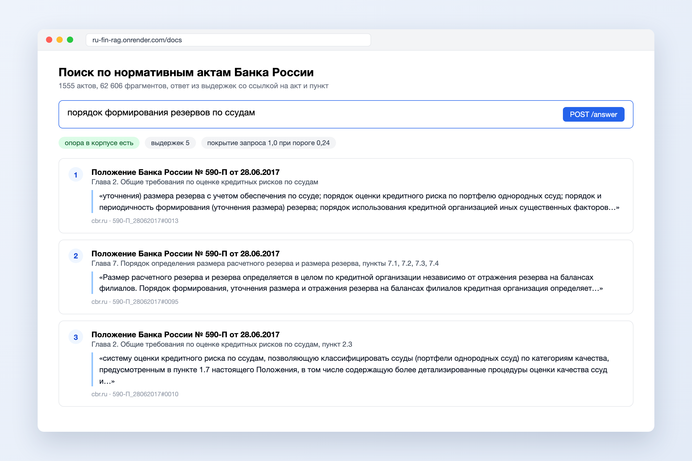

  
  

  <picture>
    <source media="(prefers-color-scheme: dark)" srcset="img/name-en-dark.svg">
    
  </picture>

  
  
  

  
  
  
  
  
  
  
  

---

**ML Engineer / Data Scientist · MSc in Machine Learning on Texts and Graphs (with honours)**

I build ML systems end to end, from collecting the data to a measured model and a service that runs on its own. Behind it are nearly six years of applied practice in econometrics and financial analysis, so analytics and causal inference are part of the job too, from forecasts and price indices to event studies and difference-in-differences. Financial University under the Government of the Russian Federation, BSc in Economics and MSc in Applied Mathematics and Computer Science, both with honours. Contributor to open-source LLM evaluation frameworks, 4 merged pull requests.

---

### [msk-rent-market](https://github.com/nata2627/msk-rent-market)

**Moscow rental market panel, collected every day since 22 Sep 2026** 
[Live dashboard](https://nata2627.github.io/msk-rent-market/) · [methods](https://github.com/nata2627/msk-rent-market/tree/main/methods) · [Telegram bot](https://github.com/nata2627/msk-rent-market/blob/main/methods/bot.md)

- **Data.** The full CIAN long-term rental feed every day, about 85 thousand listings and 1.1 million daily observations. The search is split recursively around the 1,512-listing cap, median daily completeness 97.7%.
- **Fair price.** CatBoost against hedonic regression, MAPE 12.6% vs 17.6%, 80% conformal interval, weekly retraining tracked in MLflow, served by the bot's `/price` command.
- **Forecast and index.** Backtest of four models on 141 months of Rosstat data, the selection rule committed before the first run. Random walk wins, MAPE 1.88% vs 2.69% for SARIMA. Hedonic rent index on the panel.
- **Causal questions.** A pet permission costs nothing (−0.3%, interval −1.1% to +0.6%), a listing lives 14 days in the median (Kaplan-Meier), the effect of a price cut is estimated with a daily hazard model, matching and placebo.
- **Bot.** Finds flats from a plain phrase (rules parse 78 of 80 test phrases, GigaChat 75) and answers market questions with `/ask`, GigaChat picks one of seven whitelisted query functions, 58 exact calls out of 60.
- **Reliability.** A watchdog every 20 minutes, 52 of 58 days fully covered, encrypted nightly backups. PostgreSQL 16, dbt marts, D3 dashboard on GitHub Pages, 864 tests in GitHub Actions.

### [ru-fin-rag](https://github.com/nata2627/ru-fin-rag)

**Search and answers over Bank of Russia regulations** 
[Live service](https://ru-fin-rag.onrender.com) · [API](https://ru-fin-rag.onrender.com/docs) · [dataset](https://huggingface.co/datasets/nata2627/ru-fin-retrieval) and [reranker](https://huggingface.co/nata2627/ru-fin-reranker) on Hugging Face

- **Corpus.** 1,555 regulations and 62,606 chunks. A nightly GitHub Actions run downloads new acts, rebuilds the index and checks quality, 42 scheduled runs in a row over 21 days with no manual start.
- **Search quality.** 991 labelled queries, hybrid search with cross-encoder reranking scores 0.710 NDCG@10 against 0.571 for BM25 (p < 0.001), a stemmer in BM25 tokenization added 0.087.
- **Service.** FastAPI on the Render free tier, p50 470.6 ms and p95 669.3 ms from Moscow, 140-165 requests per second per process under locust with zero failures, fits in 512 MB.
- **Answers.** Excerpts with citations to the act and paragraph, refusal when the corpus has no support.
- **Data platform.** Query log in ClickHouse with 8 dbt models, Airflow DAG, vector stores compared (numpy, FAISS, Qdrant), int8 quantization costs 0.005 NDCG.
- **Negative results.** The fine-tuned reranker added +0.013, below the threshold set before training, so it was not shipped.

---

### Other projects

| Project | What it is |
|---|---|
| [moex-index-effect](https://github.com/nata2627/moex-index-effect) | What happens to a stock when it enters or leaves the IMOEX index. 42 events over 2022-2026, event study, matching, difference-in-differences, 1,000 placebo dates. No classic index effect, prices fall after inclusion instead, CAR −18.3% over 60 days, placebo p = 0.039 |
| [ab-test](https://github.com/nata2627/ab-test) | Randomized ad experiment on Criteo Uplift v2.1, about 14 million users. Randomization turned out conditional and the naive difference overstates the effect by 40%. Peeking inflates A/A false positives to 21.2%, a sequential test brings them back to 5.5%, CUPED narrows the interval by 10.4% |
| [anglicism_detection](https://github.com/nata2627/anglicism_detection) | **Master's thesis.** XGBoost finds anglicisms in Russian news, F1 0.995 on 10,000 test words. Fine-tuned Qwen2.5-1.5B-Instruct rewrites them, BLEU 0.807 against 0.595 for ruGPT-3 Large |
| [moex-market-analytics](https://github.com/nata2627/moex-market-analytics) | Stock market mart with all analytics in SQL. 46 index stocks, `staging → core → marts`, window functions, materialized views, a composite index cut a query from 1.031 to 0.223 ms, Metabase dashboard |
| [rbc.ru-category-classification](https://github.com/nata2627/rbc.ru-category-classification) | RBC news in seven sections. Own scraper, 8,142 articles, four architectures, the simplest bag-of-words network won (79%) |

### Open-source contributions

| Project | What it is | Contribution |
|---|---|---|
| [EleutherAI/lm-evaluation-harness](https://github.com/EleutherAI/lm-evaluation-harness/pulls?q=author%3Anata2627) | reference framework for evaluating language models | 2 PRs merged, 3 in review |
| [comet-ml/opik](https://github.com/comet-ml/opik/pulls?q=author%3Anata2627) | evaluation and tracing for LLM applications | 2 PRs merged |
| [run-llama/llama_index](https://github.com/run-llama/llama_index/pulls?q=author%3Anata2627) | framework for RAG and document agents | 2 PRs in review |

### Stack

**Languages** Python · SQL · R · LaTeX

**Data and ML** pandas · numpy · statsmodels · scikit-learn · XGBoost · CatBoost · conformal prediction · MLflow · survival analysis (Kaplan-Meier) · entity resolution · graph ML (networkx, node embeddings) · matplotlib · seaborn · Jupyter

**Time series** ETS · SARIMA · STL · rolling-origin backtesting · price indices

**NLP and LLM** PyTorch · TensorFlow · transformers · datasets · accelerate · sentence-transformers · LLM fine-tuning and quantization (bitsandbytes, auto-gptq) · BM25, hybrid search and cross-encoders · retrieval and generation evaluation (NDCG, BLEU, ROUGE) · lm-evaluation-harness · LlamaIndex · Haystack · spaCy · nltk · natasha · Rasa

**Econometrics and causal inference** OLS with assumption diagnostics · hypothesis testing · hedonic regression · linear probability and hazard models · logit and probit · CAPM and beta · event study · difference-in-differences with fixed effects · matching · instrumental variables · CUPED · randomization inference and placebo tests · clustered standard errors · multiple testing corrections (Holm, Benjamini-Hochberg)

**Finance** DCF · multiples · fundamental and technical analysis

**SQL** window functions · CTE · materialized views · indexes and `EXPLAIN ANALYZE` · statistical aggregates

**Data and infrastructure** PostgreSQL · ClickHouse · MongoDB · Neo4j · ArangoDB · dbt · Airflow · FastAPI · Docker · Docker Compose · GitHub Actions · pytest · locust · Playwright · BeautifulSoup · Qdrant · FAISS · Metabase · Yandex DataLens · D3 · DVC · S3 · Render · Telegram Bot API · GigaChat API · Git · Excel

### Publications

Peer-reviewed journals from the Russian Higher Attestation Commission (VAK) list, indexed in RSCI. Titles are translated, the papers are in Russian.

- **Combating Insurance Fraud in the Digital Environment.** Samoupravlenie, 2023, No. 1 (134) · [elibrary](https://elibrary.ru/item.asp?id=50470488)
- **Analysis of the Unit Asking Price of One-Room Apartments in the Secondary Housing Market of Cheboksary**, with S. G. Sternik. Russian Economic Online Journal, 2022, No. 4 · [elibrary](https://elibrary.ru/item.asp?id=50243872)
- **The Impact of the COVID-19 Pandemic on the Financial Performance of Retail Companies.** Samoupravlenie, 2022, No. 4 (132) · [elibrary](https://elibrary.ru/item.asp?id=49288478)
