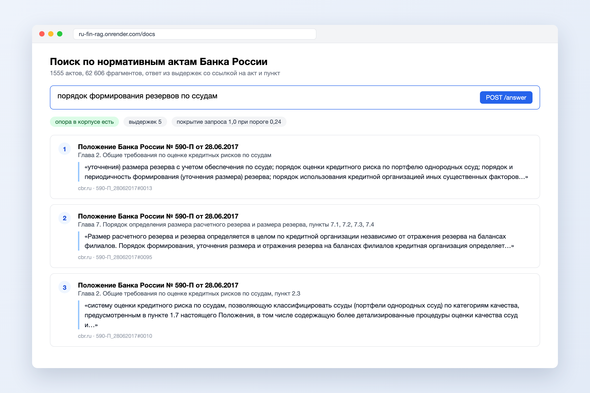

  
  

<h1 align="center">Привет, я Наталия Гордеева 👋</h1>

  

  
  
  

  
  
  
  
  
  
  
  

---

**ML-инженер / Data Scientist · магистратура «Машинное обучение на текстах и графах», с отличием**

Строю ML-системы целиком, от сбора данных до измеренной модели и сервиса, который работает сам. За этим почти шесть лет прикладной практики в эконометрике и финансовом анализе, поэтому аналитика и причинный вывод тоже моя работа, от прогнозов и индексов цен до event study и разности разностей. Финансовый университет при Правительстве РФ, бакалавриат «Экономика» и магистратура «Прикладная математика и информатика», оба диплома с отличием. Контрибьютор открытых фреймворков для оценки языковых моделей, 4 принятых pull request.

---

### [msk-rent-market](https://github.com/nata2627/msk-rent-market)

**Панель рынка аренды Москвы, сбор каждый день с 22.09.2026** 
[Витрина](https://nata2627.github.io/msk-rent-market/) · [методы](https://github.com/nata2627/msk-rent-market/tree/main/methods) · [бот в телеграме](https://github.com/nata2627/msk-rent-market/blob/main/methods/bot.md)

- **Данные.** Вся выдача длительной аренды ЦИАНа каждый день, около 85 тысяч объявлений и 1,1 млн дневных наблюдений. Выдача рекурсивно делится на корзины в обход лимита 1512 объявлений, полнота в медиане 97,7%.
- **Справедливая цена.** CatBoost против гедонической регрессии, MAPE 12,6% против 17,6%, 80%-интервал конформным предсказанием, переобучение раз в неделю с учетом в MLflow, отвечает в боте командой `/price`.
- **Прогноз и индекс.** Бэктест четырех моделей на 141 месяце Росстата, правило выбора запушено до первого расчета. Выиграло случайное блуждание, MAPE 1,88% против 2,69% у SARIMA. Гедонический индекс аренды по панели.
- **Причинные вопросы.** Разрешение держать животных ничего не стоит (−0,3%, интервал от −1,1% до +0,6%), объявление живет в медиане 14 дней (Каплан-Мейер), эффект снижения цены оценен моделью дневного риска, сопоставлением и плацебо.
- **Бот.** Подбирает квартиры по обычной фразе (правила точно разбирают 78 тестовых фраз из 80, GigaChat 75) и отвечает на вопросы о рынке командой `/ask`, GigaChat выбирает одну из семи функций-запросов из белого списка, точных вызовов 58 из 60.
- **Надежность.** Сторож каждые 20 минут, 52 из 58 дней покрыты полным обходом, зашифрованные ночные копии базы. PostgreSQL 16, витрины в dbt, дашборд на D3 и GitHub Pages, 864 теста в GitHub Actions.

### [ru-fin-rag](https://github.com/nata2627/ru-fin-rag)

**Поиск и ответ по нормативным актам Банка России** 
[Живой сервис](https://ru-fin-rag.onrender.com) · [API](https://ru-fin-rag.onrender.com/docs) · [набор](https://huggingface.co/datasets/nata2627/ru-fin-retrieval) и [переранжировщик](https://huggingface.co/nata2627/ru-fin-reranker) на Hugging Face

- **Корпус.** 1555 актов и 62 606 фрагментов. Ночной прогон на GitHub Actions докачивает новые акты, пересобирает индекс и проверяет качество, 42 плановых прогона подряд за 21 сутки без ручного запуска.
- **Качество поиска.** 991 размеченный запрос, гибрид с переранжированием кросс-энкодером дает 0,710 NDCG@10 против 0,571 у BM25 (p < 0,001), стеммер в токенизации BM25 прибавил 0,087.
- **Сервис.** FastAPI на бесплатном тарифе Render, из Москвы p50 470,6 мс и p95 669,3 мс, под нагрузкой (locust) один процесс держит 140-165 запросов в секунду без отказов, укладывается в 512 МБ.
- **Ответ.** Выдержки с цитатами на акт и пункт, отказ, если опоры в корпусе нет.
- **Данные.** Журнал запросов в ClickHouse с витриной из 8 моделей dbt, DAG на Airflow, сравнение векторных хранилищ (numpy, FAISS, Qdrant), квантизация int8 стоит 0,005 NDCG.
- **Отрицательные результаты.** Дообученный переранжировщик прибавил 0,013, меньше порога, записанного до обучения, поэтому в сервис не вошел.

---

### Другие проекты

| Проект | Что это |
|---|---|
| [moex-index-effect](https://github.com/nata2627/moex-index-effect) | Что происходит с ценой и ликвидностью акции при включении в индекс IMOEX и исключении из него. 42 события за 2022-2026 годы, event study, матчинг, разность разностей, 1000 плацебо-дат. Классического эффекта нет, зато после включения цена снижается, CAR −18,3% за 60 дней, плацебо p = 0,039 |
| [ab-test](https://github.com/nata2627/ab-test) | Рандомизированный рекламный эксперимент на Criteo Uplift v2.1, около 14 млн пользователей. Рандомизация оказалась условной, простая разница завышает эффект на 40%. Подглядывание поднимает ложные срабатывания A/A до 21,2%, последовательный тест возвращает их к 5,5%, CUPED сужает интервал на 10,4% |
| [anglicism_detection](https://github.com/nata2627/anglicism_detection) | **Магистерская работа.** XGBoost находит англицизмы в новостях, F1 0,995 на 10 000 тестовых слов. Дообученный Qwen2.5-1.5B-Instruct переписывает их, BLEU 0,807 против 0,595 у ruGPT-3 Large |
| [moex-market-analytics](https://github.com/nata2627/moex-market-analytics) | Витрина фондового рынка, вся аналитика в SQL. 46 бумаг индекса, слои `staging → core → marts`, оконные функции, материализованные представления, составной индекс ускорил запрос с 1,031 до 0,223 мс, дашборд в Metabase |
| [rbc.ru-category-classification](https://github.com/nata2627/rbc.ru-category-classification) | Новости РБК по семи рубрикам. Собственный парсер, 8142 статьи, четыре архитектуры, выиграла самая простая сеть на мешке слов (79%) |

### Вклад в открытые проекты

| Проект | Что это | Вклад |
|---|---|---|
| [EleutherAI/lm-evaluation-harness](https://github.com/EleutherAI/lm-evaluation-harness/pulls?q=author%3Anata2627) | референсный фреймворк оценки языковых моделей | 2 PR приняты, 3 на ревью |
| [comet-ml/opik](https://github.com/comet-ml/opik/pulls?q=author%3Anata2627) | оценка и трассировка LLM-приложений | 2 PR приняты |
| [run-llama/llama_index](https://github.com/run-llama/llama_index/pulls?q=author%3Anata2627) | фреймворк для RAG и документных агентов | 2 PR на ревью |

### Стек

**Языки** Python · SQL · R · LaTeX

**Данные и ML** pandas · numpy · statsmodels · scikit-learn · XGBoost · CatBoost · конформные интервалы · MLflow · анализ выживаемости (Каплан-Мейер) · дедупликация объектов · ML на графах (networkx, эмбеддинги вершин) · matplotlib · seaborn · Jupyter

**Временные ряды** ETS · SARIMA · STL · бэктест скользящим началом · индексы цен

**NLP и LLM** PyTorch · TensorFlow · transformers · datasets · accelerate · sentence-transformers · дообучение и квантизация LLM (bitsandbytes, auto-gptq) · BM25, гибридный поиск и кросс-энкодеры · оценка качества поиска и генерации (NDCG, BLEU, ROUGE) · lm-evaluation-harness · LlamaIndex · Haystack · spaCy · nltk · natasha · Rasa

**Эконометрика и причинный вывод** МНК с диагностикой предпосылок (автокорреляция, гетероскедастичность, мультиколлинеарность) · проверка гипотез · гедоническая регрессия · линейная вероятностная модель и модель риска · логит и пробит · CAPM и бета · event study · разность разностей с фиксированными эффектами · matching · инструментальные переменные · CUPED · рандомизационный вывод и плацебо-тесты · кластеризованные ошибки · поправки на множественность (Холм, Бенджамини-Хохберг)

**Финансы** DCF · мультипликаторы · фундаментальный и технический анализ

**SQL** оконные функции · CTE · материализованные представления · индексы и `EXPLAIN ANALYZE` · статистические агрегаты

**Данные и инфраструктура** PostgreSQL · ClickHouse · MongoDB · Neo4j · ArangoDB · dbt · Airflow · FastAPI · Docker · Docker Compose · GitHub Actions · pytest · locust · Playwright · BeautifulSoup · Qdrant · FAISS · Metabase · Yandex DataLens · D3 · DVC · S3 · Render · Telegram Bot API · GigaChat API · Git · Excel

### Публикации

Журналы перечня ВАК, индексируются в РИНЦ.

- **Борьба со страховым мошенничеством в цифровой среде.** Самоуправление, 2023, № 1 (134) · [elibrary](https://elibrary.ru/item.asp?id=50470488)
- **Анализ удельной цены предложения однокомнатных квартир на вторичном рынке г. Чебоксары**, в соавторстве с С. Г. Стерником. Российский экономический интернет-журнал, 2022, № 4 · [elibrary](https://elibrary.ru/item.asp?id=50243872)
- **Анализ влияния пандемии COVID-19 на финансовые результаты компаний-ритейлеров.** Самоуправление, 2022, № 4 (132) · [elibrary](https://elibrary.ru/item.asp?id=49288478)
